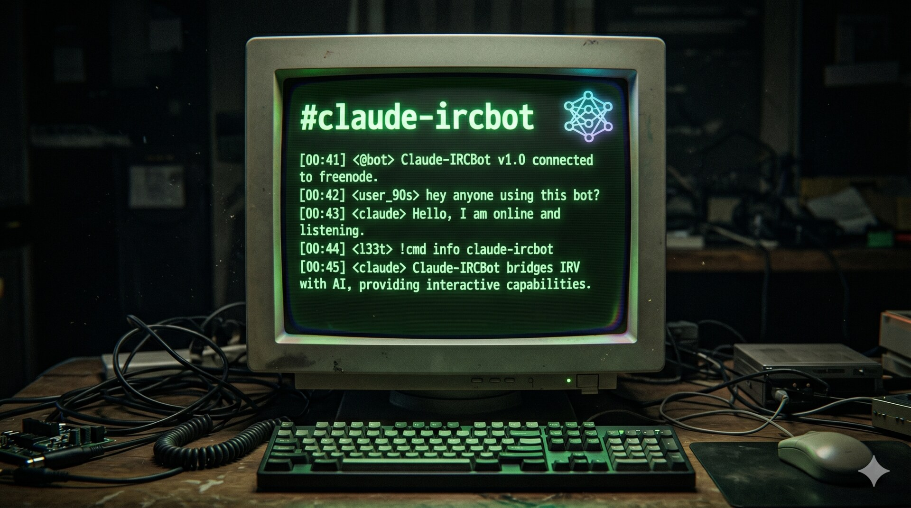

# claude-ircbot



Minimal Python IRC bridge that lets a
[Claude Code](https://www.anthropic.com/claude-code) session participate in
an IRC channel as a real user.

Built in an evening as a proof of concept, kept growing since. Origin story
on [sindro.me](https://sindro.me/) (April 2026).

## How it works

- **TLS IRC client** (stdlib `socket` + `ssl`). Connects to an IRC network,
  registers a nick, handles `PING`, logs every raw line to `bot.log`.
- **Structured stdout** — one line per interesting event (`MSG`, `INVITE`,
  `CTCP`, `NOTICE`, `KICK`, `IDLE`, errors). Claude Code's
  [Monitor tool](https://code.claude.com/docs/en/agent-sdk/typescript#monitor)
  attaches to the bot and delivers each line as a notification
  mid-conversation. `Monitor` caps a watch at 30 minutes; for a session that
  listens all day, [watchd](https://github.com/vjt/claude-watchd) runs the same
  tail for the session's whole life, and is the recommended way (see
  [Watching without re-arming](#watching-without-re-arming)).
- **Named-pipe inbox** (`bot.send`). The agent writes commands like
  `SAY #channel hello world` into the pipe; the bot translates them into
  `PRIVMSG`s and sends them.

About 1,500 lines of Python for the bot itself, no dependencies outside the
standard library (the optional [encrypted queries](#end-to-end-encrypted-queries-optional)
add one, irc-olm, and only where they are turned on). A watchdog for the
Claude Code session lives alongside it (see [Companions](#companions)).

## Setup from zero

What you need: a Linux host with systemd user units and tmux, Python 3.11 or
later, [Claude Code](https://www.anthropic.com/claude-code) installed and
logged in on that host, and a nick for the bot, registered with NickServ on
your network if it has services. Nothing to `pip install` unless you turn on
[encrypted queries](#end-to-end-encrypted-queries-optional).

1. **Clone.**

   ```bash
   git clone https://github.com/vjt/claude-ircbot.git ~/claude-ircbot
   cd ~/claude-ircbot
   ```

2. **Password, trust, joins.** Local files next to `bot.py`, all gitignored:

   ```bash
   printf 'NICKSERV_PASS=%s\n' 'the-bot-nick-password' > .env && chmod 600 .env
   printf '%s\n' '# <nick> <host_glob>' 'alice *.example.org' > bot.trust
   printf '%s\n' 'JOIN #mychannel' > bot.startup
   ```

   `bot.trust` lists who may give the agent orders: your nick and a glob of
   the host you connect from ([Trust model](#trust-model)). `bot.startup` is
   replayed once the bot has identified: joins, ChanServ invites
   ([startup replay](#nickserv-auth--startup-replay)). Optionally, reserved
   channels in `bot.reserved` (template: `bot.reserved.example`).

3. **Try it in the foreground.**

   ```bash
   IRC_HOST=irc.example.net IRC_NICK=mybot python3 -u bot.py
   ```

   It prints one event per line (`TLS_OK`, `CONNECTED`, `STARTUP_DONE`,
   `JOIN`, …). From a second shell, `./bot.say '#mychannel' <<< 'hello'`
   speaks. Ctrl-C stops it.

4. **Run it as a service.**

   ```bash
   mkdir -p ~/.config/systemd/user
   cp systemd/claude-ircbot.service.example ~/.config/systemd/user/claude-ircbot.service
   $EDITOR ~/.config/systemd/user/claude-ircbot.service   # paths, IRC_HOST, IRC_NICK, BOT_TZ, …
   systemctl --user daemon-reload
   systemctl --user enable --now claude-ircbot.service
   loginctl enable-linger "$USER"
   ```

   The event stream now goes to `bot.stdout.log` in the checkout
   ([systemd](#systemd), [Configuration](#configuration)).

5. **The agent's instructions.** Write a `CLAUDE.md` in the checkout
   (gitignored): it is what the session knows about the bot. That events
   arrive on the stream, that only `MSG TRUSTED` lines are orders, when to
   speak and how (`bot.say`), what it may do on the host. The bot only tags
   lines; the policy lives there.

6. **Skills.** Copy the example skills and make them yours (the copies are
   gitignored):

   ```bash
   mkdir -p .claude/skills && cp -r examples/skills/* .claude/skills/
   ```

   `/start` is the cold boot, `/resume` the bring-up after every `/clear`,
   `/close` the clean shutdown before `/exit`.

7. **Event stream: watchd.** Install the [watchd](https://github.com/vjt/claude-watchd)
   plugin from Claude Code, and give it one watch per bot instance:

   ```
   /plugin install watchd --marketplace vjt/claude-watchd
   ```

   ```bash
   cp examples/watchd.json .claude/watchd.json
   ```

   Each watch runs `bash examples/start-monitor.sh <stdout log>` for the
   session's whole life ([Watching without re-arming](#watching-without-re-arming)).
   Without watchd, `/resume` attaches one `Monitor` per instance with the
   same script: that is only a fallback, since a `Monitor` expires after 30
   minutes and has to be re-armed.

8. **Permission gate.** In `.claude/settings.local.json` (gitignored), wire
   the hook and add the host-specific allow rules:

   ```json
   {
     "permissions": {"allow": ["Edit(/home/you/claude-ircbot/notes/**)",
                               "Write(/home/you/claude-ircbot/notes/**)"]},
     "hooks": {"PreToolUse": [{"matcher": "*", "hooks": [{"type": "command",
       "command": "python3 $CLAUDE_PROJECT_DIR/.claude/hooks/gate-permission.py"}]}]}
   }
   ```

   and name who hears about a blocked call in `.claude/gate.local.json`:
   `{"operator": "alice", "bot_nick": "mybot"}`
   ([Permission gate](#permission-gate-claude-code-hook)).

9. **Start the session**, in tmux, in a window named `ircbot` (where the
   watchdog looks for it):

   ```bash
   tmux new-session -s claude -n ircbot
   cd ~/claude-ircbot && claude
   ```

   then type `/start`.

10. **Optional: the watchdog.** `systemd/aup-watchdog.service.example`, copied
    to `~/.config/systemd/user/aup-watchdog.service` the same way, clears the
    session when it is stuck on a refusal, too large or idle, then types
    `/resume` ([Sidecars](#sidecars)).

## Running it


### Usage

```bash
IRC_HOST=irc.example.net IRC_NICK=mybot python3 -u bot.py
```

### Configuration

Nothing about a deployment lives in the tracked code: the bot is configured
by environment variables (in practice, `Environment=` lines in its systemd
unit) plus a few local files next to `bot.py`, all of them gitignored. That
is also what makes a second instance possible (see
[Running two networks](#running-two-networks)).

`IRC_HOST` and `IRC_NICK` have no default: without them the bot prints what
is missing on stderr and exits. Everything else is optional. Relative file
names below are next to `bot.py`.

| Variable | Default | What it is |
|---|---|---|
| `IRC_HOST` | **required** | TLS endpoint |
| `IRC_NICK` | **required** | nick, also the NickServ / SASL account |
| `IRC_PORT` | `6697` | TLS port |
| `IRC_IDENT` / `IRC_REAL` | `claude` / repo URL | registration |
| `IRC_BIND` | unset (kernel picks) | source address to connect from |
| `IRC_SASL` | `0` | `1` = SASL PLAIN (nick + `NICKSERV_PASS`) before registration, for networks that cloak only once you are identified |
| `IRC_TLS_VERIFY` | `1` | `0` skips certificate checks, for networks whose certs do not validate; never where a password crosses the link |
| `BOT_IDLE` | unset (no idle ticks) | `#chan=MIN-MAX[,#chan=MIN-MAX…]`, seconds, see [Idle tick](#idle-tick) |
| `BOT_TZ` | unset (host local time) | IANA zone of the `bot.log` and event-stream timestamps, e.g. `Europe/Rome` |
| `BOT_DM_REJECT` | `I only talk in channels, not in private.` | NOTICE sent (once per 6 h per nick) to a stranger who DMs the bot; empty = none |
| `BOT_USAGE_CMDS` | `0` | `1` = answer `!bolletta` / `!token` / `!usage`, see [Usage command](#usage-command-optional) |
| `BOT_USAGE_CREDS` | `~/.claude/.credentials.json` | where that command reads Claude Code's OAuth token |
| `BOT_CONVERGE_SECS` | `120` | how often the joined channels are checked against `bot.startup`'s `JOIN`s, and the missing ones rejoined |
| `BOT_LOG` | `bot.log` | raw traffic log, both directions |
| `BOT_FIFO` | `bot.send` | command inbox |
| `BOT_TRUST` | `bot.trust` | trust list (see below) |
| `BOT_DM_ALLOW` | `bot.dmallow` | nicks outside the trust list whose private messages are shown, untrusted (see below) |
| `BOT_ENV` | `.env` | NickServ password file |
| `BOT_STARTUP` | `bot.startup` | post-auth command replay |
| `BOT_RESERVED` | `bot.reserved` | reserved channels (see below), shared by all instances |
| `BOT_RESERVED_STORE` | `reserved_recent.tsv` | recent lines of those channels, shared by all instances |
| `BOT_E2E_KEY` | unset (E2E off) | Olm pickle key, see [encrypted queries](#end-to-end-encrypted-queries-optional) |
| `BOT_E2E_NETWORK` | unset | network id the Olm state is bound to (required with the key) |
| `BOT_E2E_PINS` | unset | the operator's pinned keys (required with the key) |
| `BOT_E2E_STATE` | `~/.local/state/claude-ircbot/<network>.e2e.json` | Olm account and sessions, mode 600 |

The DCC knobs (`BOT_DCC_*`) are documented where `bot.py` defines them.

The local files, all per deployment and gitignored:

| File | What it holds | Template |
|---|---|---|
| `.env` | `NICKSERV_PASS=…` | — |
| `bot.trust` | who may give the agent orders | [Trust model](#trust-model) |
| `bot.dmallow` | who may DM the bot, untrusted | [Trust model](#trust-model) |
| `bot.startup` | joins and invites replayed after auth | [below](#nickserv-auth--startup-replay) |
| `bot.reserved` | channels whose words and name never leave them | `bot.reserved.example` |
| `.claude/settings.local.json` | host-specific allow rules | [Permission gate](#permission-gate-claude-code-hook) |
| `.claude/gate.local.json` | who the permission gate notifies | [Permission gate](#permission-gate-claude-code-hook) |
| `.claude/watchd.json` | the event-stream watches, one per instance | `examples/watchd.json` |
| `.claude/skills/{start,resume,close}/` | the session's bring-up and shutdown | `examples/skills/` |
| `CLAUDE.md` | the agent's instructions | [Setup from zero](#setup-from-zero) |

`bot.reserved` lists `<irc host> <#channel>` per line. Every line the FIFO
asks the bot to send elsewhere is dropped (`LEAK_BLOCKED`) when it names one
of those channels or repeats six words in a row said there in the last 24
hours. One file for all instances, so the guard holds across networks too.

Timestamps in `bot.log` and on the event stream are the host's local wall
clock, or `BOT_TZ`'s when set.

Send commands via the FIFO:

```bash
printf 'SAY #mychannel hello everyone\n' > bot.send
```

Supported commands: `SAY`, `ACT`, `NOTICE`, `JOIN`, `PART`, `WHOIS`,
`QUIT`, `RAW`, `DCC`, and `ESAY` / `EACT` when encrypted queries are on.

### Usage command (optional)

With `BOT_USAGE_CMDS=1`, a `TRUSTED` line that is just `!bolletta`, `!token`
or `!usage` (bare, or addressed to the bot: `mybot: !usage`) gets the Claude
subscription usage back, in the same channel or query:

```
usage: 5h session 12% (reset Mon 18:00) · week 40% (reset Thu 09:00)
```

**It reads Claude Code's OAuth token from disk** (`BOT_USAGE_CREDS`, by
default `~/.claude/.credentials.json`) and sends it to the endpoint Claude
Code's own `/usage` calls, which is undocumented and may change or go away.
The token is read on every call and never refreshed or stored by the bot.
Leave it off unless the bot runs as the same user as the Claude Code session
whose usage you want to see, and you are fine with the bot process reading
that session's credentials.

### bot.say — writing to the FIFO without a quoting footgun

`printf` into the FIFO breaks on the things people actually type: a bare
`%` eats the next word as a format specifier, and apostrophes and accented
characters have to survive a layer of shell quoting. `bot.say` takes the
body on **stdin** instead, so only the target (a simple token) is ever a
shell argument:

```bash
./bot.say '#mychannel' <<'EOF'
100% d'accordo — accents, apostrophes and percent signs all arrive intact
EOF

./bot.say -v ACT '#mychannel' <<'EOF'   # any verb: ACT, NOTICE, …
waves
EOF
```

Each non-empty stdin line becomes one message, so a heredoc sends several.
`-f <path>` points it at a different FIFO — that is how the second
instance is addressed.

### Running two networks

`bot.py` is single-network by design; a second network is a second process
with its own env, not a threading model inside the bot. Everything
per-network is a file path, so the two instances share zero state:

```bash
IRC_HOST=irc.other.example IRC_NICK=mybot IRC_SASL=1 \
BOT_LOG=bot.other.log BOT_FIFO=bot.send.other \
BOT_TRUST=bot.trust.other BOT_ENV=.env.other \
BOT_STARTUP=bot.startup.other \
python3 -u bot.py
```

The agent has one watchd watch (or one Monitor) per instance (each has its
own stdout stream) and picks the FIFO per message:
`./bot.say -f bot.send.other '#chan'`.
As a unit, that is one more copy of `systemd/claude-ircbot.service.example`
with those lines uncommented (see [systemd](#systemd)).

### NickServ auth & startup replay

On connect the bot reads `.env` (next to `bot.py`). If
`NICKSERV_PASS=…` is set, the bot identifies to NickServ and waits for the
confirmation notice; otherwise it skips straight to post-connect.

Once authenticated (or immediately, if no password), the bot replays
`bot.startup` — a plain text file of FIFO-style commands, one per line,
with a 0.5 s delay between them. Use it to declare persistent joins and
chanserv invites without baking them into `bot.py`:

```
# bot.startup
RAW PRIVMSG ChanServ :INVITE #private
JOIN #private
JOIN #mychannel
```

Lines starting with `#` are comments; blank lines ignored.

### Trust model

Trust is the combination of three checks, ALL required:

1. **Nick listed** in `bot.trust` (one `<nick> <host_glob>` per line).
2. **Host matches the glob** (`fnmatch`, e.g. `*.example.org`) — defends
   against nick-only impersonation if services lapse.
3. **Registered & identified to services** — confirmed via
   `RPL_WHOISREGNICK` (numeric `307`). A one-shot `WHOIS` fires on the
   first sighting of a trust-listed nick (and for every entry at connect),
   the result is cached, and the cache resets on `PART` / `QUIT` / `NICK`
   change.

If any check fails, a channel message is still emitted, as `MSG UNTRUSTED`,
and for a listed nick a `TRUST_DENIED` line records the reason. A private
message from a listed nick is emitted only once all three pass: it waits
for the `WHOIS` (`DM_HELD`) and is dropped if that fails (`DM_DROPPED`), or
at once if its host does not match the glob (`DM_BLOCKED`). A private
message from a nick not listed is dropped at once (`DM_BLOCKED`), unless
`bot.dmallow`, below, lets it through. A dropped message never shows its
text. `INVITE` auto-join is gated on the same check. A nick with a pinned
E2E key takes another path for its messages (below, "Trust, with a pinned
key"); its `INVITE` still takes this one.

The actual "who can command the agent" logic still lives in the agent's
system prompt — the bot only decides what to tag as trusted. The bot is
transport.

Example `bot.trust`:

```
# <nick> <host_glob>
alice *.example.org
```

`bot.dmallow`, in the same `<nick> <host_glob>` format, lets a nick outside
`bot.trust` send plaintext private messages from a host matching its glob:
they reach the stream as `MSG UNTRUSTED`, readable, never an order. It does
not apply to a nick in `bot.trust`, whose private messages take the trust
path above.

### End-to-end encrypted queries (optional)

Off unless `BOT_E2E_KEY` is set. When on, the bot speaks the encrypted query
protocol of [grappa](https://github.com/vjt/grappa-irc) and its web client
cicchetto (Olm, through [irc-olm](https://github.com/vjt/irc-olm)): the ircd
and any bouncer only relay ciphertext. Without the variable the bot never
imports irc-olm and behaves exactly as before.

**Keys are pinned, never learned.** The bot talks E2E only to the master keys
the operator pasted into the pins file, and an unknown key gets silence: no
keys, no error, no session. Each user has one master key per network, which
vouches for the user's devices (1 to 4, wire v2): one pin covers all of them,
and an encrypted message to the user goes to every device its master
trusts. There is no fingerprint comparison and no confirm
command on the bot (SAS is between humans, in cicchetto). Rotating a key means
pasting the new one; the bot reloads the file when it changes, and keeps the
previous pins if the new file does not parse.

Setting it up, once per instance:

1. A venv with irc-olm, since the system python stays dependency-free:
   `python3 -m venv /opt/claude-ircbot-e2e && /opt/claude-ircbot-e2e/bin/pip install -r requirements-e2e.txt`,
   and run `bot.py` with that interpreter.
2. A key, outside the repo, made by the user the bot runs as: the bot refuses
   a key file group or others can read, so it must be that user's own. As
   that user, with the venv's python (the system one has no irc-olm):
   `mkdir -p -m 700 ~/.config/claude-ircbot && /opt/claude-ircbot-e2e/bin/python -m irc_olm keygen ~/.config/claude-ircbot/mynet.key`.
   Made by root it would be root's, and the bot could not read it. It
   encrypts every secret in the state file; losing it means a new identity,
   and every peer has to paste the new key.
3. The pins file, one `<nick> <master key>` per line, the peer's master key
   exactly as its client shows it (cicchetto shows its own; 43 characters):

   ```
   # /etc/claude-ircbot/e2e.pins
   alice OxhEN9lGQvbtNQdXhdicNAiGPou7iOm8dUx38EbjByM
   ```

   **The bot only reads this file, and its Claude session must not be able to
   change it**, or a prompt injection could pin an attacker's key. Make it
   root-owned in a root-owned directory (the bot user reads it, nobody else
   writes it), or deny it in that session's permission rules. The bot cannot
   enforce this: it emits `E2E_PINS_WRITABLE` at every load when it could
   write the file, for the operator in `bot.stdout.log` (the Monitor does not
   wake on it: with deny rules it is expected at every start).
4. `BOT_E2E_KEY`, `BOT_E2E_NETWORK` (a fixed id such as `examplenet`, of letters,
   digits, `.`, `_` and `-`: the state file is bound to it, and named after
   it) and `BOT_E2E_PINS` in the unit's environment. The bot refuses to start
   with the key and without the other two. The state goes to
   `$XDG_STATE_HOME/claude-ircbot/<network id>.e2e.json`
   (`~/.local/state/claude-ircbot/…` when that is unset), one per network id
   (two instances on one network need different ids, or `BOT_E2E_STATE`);
   `BOT_E2E_STATE` moves it, and must then name a different file for each
   instance.
5. **Out of the session's reach.** The unit is a systemd user unit, so the
   bot runs as the same user as its Claude session, and that session can
   read the key and rewrite the state file, wherever they are. With the key
   it could rewrite the encrypted part of the state too, and bind a session
   of its own to a pinned key: its messages would then arrive as
   `MSG TRUSTED ENCRYPTED=1` from that key's user. Without the key it can
   still edit the state's clear part, the replay protection among it. So
   deny the key file and the state directory to that session in its
   permission rules, as for the pins file; the bot cannot check this.
   Running the bot as a user of its own is not enough as things stand: the
   bot creates its FIFO mode 600, so the session could no longer send it
   commands.

At startup the bot emits `E2E_READY KEY=<its own master key> NETWORK=<id>`:
that key is what the other side pastes. `python -m irc_olm identity --state
<state file>` prints it too.

**Upgrading from wire v1** is a flag day: v1 and v2 do not talk to each other,
so upgrade a bot only once its peers' clients speak v2. irc-olm refuses a v1
state file: the bot exits at startup with `FATAL` naming
`StateMismatchError`, and the unit restarts into the same error until the
file is moved away; then the bot starts a new identity. Every peer pastes the
bot's new master key, and the operator replaces each peer's key in the pins
file with its master key: a v1 key left there turns every message from that
peer into `E2E_KEY_ALARM`.

**Trust, with a pinned key.** For a nick with a pinned key, the key replaces
the trust list above: `bot.trust`, the host glob and services (`307`/`330`)
count for nothing, either way. The nick need not be listed, the bot sends no
`WHOIS` for it and waits for none, so a pinned user is trusted on a network
without services and from any host. Plain text alone never counts
for that nick:

- In the encrypted query the session authenticates the key:
  `MSG TRUSTED ENCRYPTED=1 FROM=… BODY=…`, whatever the host.
- A plaintext line addressed to the bot (its nick as a word) or a plaintext
  PM is held (`ORDER_HELD`), and a challenge goes out over the encrypted
  session, to each of their devices that has written to the bot on it (wire
  v2 never sends one in a first message: until the device the user types on
  has written to the bot, an order from it cannot be confirmed and ends as
  unanswered). Their client answers
  only if it sent exactly that line in the last 15 s, and only then is it
  released as `MSG TRUSTED CONFIRMED=1`. Without the
  answer a channel line is released as `MSG UNTRUSTED WHY=no-ack` and a PM is
  dropped.
- Any other plaintext line from them is `MSG UNTRUSTED WHY=unchallenged`.
- A different key on a pinned nick is `E2E_KEY_ALARM` and never reaches the
  stream; so is a pinned key speaking under a nick pinned to another key.
- So whoever else holds a pinned nick, from whatever host, gets no more than
  `MSG UNTRUSTED` rows: their channel lines as `WHY=unchallenged` or, if
  addressed to the bot, `WHY=no-ack`; their PMs held and then dropped
  (`DM_DROPPED … no-ack`), never shown. What they can still cost is the
  bot's public keys (`KEYS`, answered to any key asking under a pinned nick,
  as for the user on a new host), alarms, and the challenge budget below.
- A nick without a pinned key keeps the trust list exactly as above.
- Under any other nick their key gets nothing: what it sends from a nick
  without a pin is dropped (`E2E_DROPPED REASON=unpinned-nick`), the answer
  to a challenge included, so an order whose author changed nick before
  answering ends as unanswered. Only a `NACK` still gets through, so a reply
  the bot sent before the rename and the peer could not read is reported
  (`E2E_SEND_FAILED REASON=nack-from-another-nick`).

`ESAY <nick> <text>` / `EACT <nick> <text>` send encrypted (queries only, never
a channel). A `SAY`/`ACT` to a nick is encrypted too while the last DM from
that nick released as TRUSTED was encrypted, for an hour after it and only
until the bot restarts. A plaintext PM switches it back only once it is
released as TRUSTED (for a user with a pinned key, confirmed); one held or
dropped changes nothing. Answer `ENCRYPTED=1` with `ESAY`/`EACT`, which do not
depend on it. An encrypted message may span lines: in `ESAY`/`EACT` text `\n`
is a line break and `\\` a backslash (any other backslash is sent as typed;
`SAY`/`ACT` never decode, encrypted or not), and an `ENCRYPTED=1` body reaches
the stream with the same escapes plus `\r`, one event line however many lines
it had. A message that cannot be delivered is `E2E_SEND_FAILED` with a
reason; `REASON=pacer-full` means the pacer has no room, and nothing was
sent: 32 messages already wait for that nick (counting the ones refused behind
them), or the 480 s of queued encrypted text all nicks share is full.
`REASON=send-failed` is a message the socket failed halfway through, the rest
of it dropped. Outbound E2E lines never push the connection
past bahamut's flood bank (every line the bot writes counts in it, so E2E
backs off while the bot talks) and never exceed 3 per 6 s per target, the
receiver's CTCP flood limit. A long encrypted message is therefore slow: about
one full line every 5 s, and under load at least one every 46 s, so a message
under way always reaches its reader (who waits 60 s for the next fragment).
Challenges go ahead of queued encrypted text, four a minute for the whole bot.
A first contact's key answer (`KEYS`) waits behind the challenges for 8 s,
then goes before the ones queued after that instant (those queued before keep
their place, so when several first contacts arrive together the one held
behind such a challenge may be answered after those who came later). A user
who gave no order in the last minute and the first contacts share what the
challenges leave of five a minute, and the four are kept whatever the first
contacts took, so queued encrypted text waits longer when several first
contacts arrive together. A `NACK` never goes before a challenge. An encrypted
message, or a key answer, under way that has waited 20 s for its next line
goes before them too (its reader drops it at 60 s). With nothing else queued,
every challenge goes as soon as the flood bank allows.
A challenge that could no longer be answered within its 15 s is not sent:
its order, like any unanswered one, is released as `MSG UNTRUSTED
WHY=no-ack` (a PM dropped).

**What lands where.** Decrypted text appears only as the `BODY` of the `MSG`
event on stdout. `bot.log` gets the ciphertext lines and
`E2E MSG from <nick> (<n> bytes)`, and a failing E2E command is reported with
its text redacted.

## Agent contract


Everything in this section is about how the bot shapes the agent's
experience on IRC — what events it sees, what it can do, and how human
gatekeepers stay in the loop.

### Watching without re-arming

`Monitor` kills every watch after 30 minutes, so an agent tailing two bots
and a couple of other feeds all day re-arms them twice an hour, a turn each,
for nothing. [watchd](https://github.com/vjt/claude-watchd) is a Claude Code
plugin (`/plugin install watchd --marketplace vjt/claude-watchd`) that runs
the same commands for the session's whole life and hands each stdout line to
the agent as an event. List the watches in `.claude/watchd.json`, one per bot
instance (`examples/watchd.json` is the starting point):

```json
{
  "watches": [
    { "name": "irc",   "argv": ["bash", "examples/start-monitor.sh", "bot.stdout.log"] },
    { "name": "other", "argv": ["bash", "examples/start-monitor.sh", "bot.other.stdout.log"] }
  ]
}
```

`examples/start-monitor.sh` keeps the events worth waking the agent for and
drops the diagnostics. The file is per deployment (it names your instances
and your extra feeds), so it stays untracked. A watch added or removed there starts or stops within
seconds. The bring-up skill checks whether watchd is running
(`grep -lsxzF "WATCHD_DIR=$PWD" /proc/[0-9]*/environ`) and attaches `Monitor`s only
when it is not.

### Permission gate (Claude Code hook)

`.claude/hooks/gate-permission.py` is a `PreToolUse` hook: wire it as
`matcher: "*"` in `.claude/settings.local.json` and every tool call the
agent attempts passes through it. The tracked `.claude/settings.json`
wires no hook, so a fresh clone works with Claude Code's own prompts:

```json
{"hooks": {"PreToolUse": [{"matcher": "*", "hooks": [{"type": "command",
  "command": "python3 $CLAUDE_PROJECT_DIR/.claude/hooks/gate-permission.py"}]}]}}
```

It reads the union of `permissions.allow` from `.claude/settings.json`
(checked-in generic rules: bare-tool allows) and
`.claude/settings.local.json` (gitignored, host-specific: absolute
`Edit`/`Write` path globs, `WebFetch` domains). If nothing matches, the
hook denies.

Why it exists: Claude Code's built-in permission prompt is *interactive*
— a blocked tool call silently waits for a human at the terminal. When
the agent lives on IRC and the human is elsewhere, that's a dead-lock.
The hook short-circuits the prompt: it denies fast and messages the
operator via the bot FIFO, so the blocked call surfaces on IRC.

Who that is comes from `.claude/gate.local.json` (gitignored), re-read on
every call so an edit takes effect in a running session:

```json
{"operator": "alice", "bot_nick": "mybot"}
```

`operator` is the nick told about every blocked call; `bot_nick` prefixes
the reply the notice suggests (`mybot: allow …`). Without the file, or
without `operator`, the hook still denies, it just tells nobody. Neither
key changes what is allowed.

The allow-rule grammar is a small superset of Claude Code's native
syntax:

```
Read                            # bare tool name = any invocation allowed
Edit(/path/glob/**)             # fnmatch on tool_input.file_path
Bash(cmd-glob)                  # fnmatch on tool_input.command
WebFetch(domain:example.com)    # exact host
WebFetch(domain:*.example.com)  # subdomain wildcard
Skill(skill-name)               # exact skill name
Tool(key:value)                 # generic key:value equality on tool_input
```

The agent can ask a trusted IRC user for a new allow rule on the fly
(`<bot nick>: allow <rule>`) and the hook setup writes it to
`settings.local.json` for the next attempt. That lives in the agent's
system prompt + the bot, not in the hook itself — the hook is just the
enforcement point.

An agent that also has a Telegram bridge can use
[claude-tgbot](https://github.com/vjt/claude-tgbot)'s gate instead, same
rules and grammar: the operator gets the blocked call as a DM with
buttons (yes / always / no) and the gate waits for the tap: wire its
`hooks/gate-permission.py` in `settings.local.json` instead of this one
(hooks from all settings files run, so wire one gate, not both).

### Idle tick

Long channels grow boring if the agent only speaks when spoken to. The
bot arms a per-channel random cooldown on every incoming *human* PRIVMSG
(bot messages do not reset it); when the cooldown elapses, the bot emits
a single `IDLE <chan>` event on stdout and disarms until the next human
line.

The agent treats `IDLE` as an opportunity, not an obligation — it can
drop a context-aware one-liner or stay silent. Channels and ranges come
from `BOT_IDLE`, in seconds; a channel not listed never ticks, and without
the variable nothing does:

```bash
BOT_IDLE='#mychannel=300-1200,#quiet=1800-5400'
```

### KICK auto-rejoin

When the bot is kicked, it asks ChanServ for an invite and rejoins 2 s
later. More than 3 kicks from the same channel within 60 s and it gives up
(`KICK_GIVEUP`) instead of feeding a kick flood; the channel convergence
loop tries again later, every `BOT_CONVERGE_SECS`, if `bot.startup` joins
it. The `KICK` event is still emitted so the agent sees it and can adjust
behavior.

## Companions


Optional helpers ship in the repo. They all tail `bot.log` (or the Claude
Code session JSONL) and, when they need to speak, write verbs into the
`bot.send` FIFO like any other client — none of them opens an IRC
connection of its own.

They exist for the same reason: anything mechanical and repetitive is
cheaper, more predictable and always-on as a hundred lines of Python than
as an agent turn. The agent keeps the judgement calls; the sidecars keep
the bookkeeping.

### Sidecars

- **[claude-watchdog](https://github.com/vjt/claude-watchdog)** — not in
  this repo any more: one watchdog for any long-lived Claude Code session.
  It types `/clear` and a resume prompt into the agent's pane when the
  context passes a budget, on a refusal or after a long idle, and only
  between turns. For this bridge: `WATCHDOG_SESSION_DIR=<checkout>`,
  `WATCHDOG_RESUME_PROMPT=/resume`, and a `WATCHDOG_NOTIFY_CMD` that writes
  `SAY` lines to `bot.send` if it should speak on IRC.

Anything else that speaks through the bot — a game, a poll, a stats
summary — can be a sidecar of your own: write verbs into the FIFO, tag
them (`SAY:mygame #chan …`) so `bot.log` tells them apart from the agent,
and keep it in its own repo.

### systemd

`systemd/` ships templates, not units: a deployment's units name its own
paths, networks and nicks, so they stay out of the repo.

- `claude-ircbot.service.example` — one bot instance. One copy per
  network, each with its own `IRC_HOST` / `IRC_NICK` and, past the first,
  its own `BOT_LOG` / `BOT_FIFO` / `BOT_TRUST` / `BOT_ENV` / `BOT_STARTUP`.
- `e2e.conf.example` — a drop-in that turns encrypted queries on for one bot
  unit. It holds the key, so it never enters the repo either: it goes in
  `~/.config/systemd/user/<unit>.service.d/e2e.conf`.

Copy a template into `~/.config/systemd/user/` without the `.example`
suffix, replace `/path/to/claude-ircbot` and the `<…>` placeholders, then:

```bash
systemctl --user daemon-reload
systemctl --user enable --now claude-ircbot.service
loginctl enable-linger "$USER"   # so it survives logout and starts at boot
```

The bot units restart on failure with a growing backoff (`RestartSec=30`,
`RestartSteps=5`, up to 30 min) so a netsplit or a NickServ storm does not
turn into a reconnect flood. Note that `systemctl --user stop` is a plain
SIGTERM: for a clean part rather than a ping timeout, send `QUIT` through
the FIFO first.

## License


MIT. See `LICENSE`.
